  

## About

QA automation engineer at **Gcore**, working on **AI-assisted QA tooling**: agent workflows that turn specs and tickets into test cases, keep those cases reviewable, and hand them over to automation.

The repositories here are small, finished and documented — the public side of that habit, not a graveyard of half-started experiments.

## Tech I use

**Languages GitHub finds in my public repos**

     

**Tools and frameworks**

         

## Public work at a glance

  <picture>
    <source media="(prefers-color-scheme: dark)" srcset="https://streak-stats.demolab.com?user=vitalii-bekshnev&amp;theme=dark&amp;hide_border=true&amp;background=00000000">
    <source media="(prefers-color-scheme: light)" srcset="https://streak-stats.demolab.com?user=vitalii-bekshnev&amp;hide_border=true&amp;background=00000000">
    
  </picture>

## Highlights

| Repository | What it does | Built with |
| --- | --- | --- |
| **[jlpt-anki-decks](https://github.com/vitalii-bekshnev/jlpt-anki-decks)** ★ 3 | JLPT N5–N1 Anki flashcard decks — 3,000+ kanji and 215,000+ vocabulary entries with example sentences and frequency tiers — rebuilt from JMdict data and released monthly (13 releases so far). Decks are browsable on [GitHub Pages](https://vitalii-bekshnev.github.io/jlpt-anki-decks/en/index.html). | Python · GitHub Actions |
| **[givegram](https://github.com/vitalii-bekshnev/givegram)** | Instagram giveaway winner picker: read a post's comments, draw random winners, animate the reveal. pytest coverage gate at 100%, ruff + mypy in CI. | Python · FastAPI · vanilla JS |
| **[pomodoro](https://github.com/vitalii-bekshnev/pomodoro)** | Pomodoro timer with cycle tracking, keyboard control, notifications and state persistence. Jest tests, ESLint, Docker image. | TypeScript · React 18 · Vite |
| **[tmux-claude-badge](https://github.com/vitalii-bekshnev/tmux-claude-badge)** | TPM plugin that shows Claude Code agent state — done / waiting / permission / agent — as badges in tmux window tabs. | Shell · tmux |

**Forks:** [mcp-testrail](https://github.com/bun913/mcp-testrail) — TestRail MCP server · [tilde](https://github.com/xvvvyz/tilde) — minimal startpage.

## Writing

- **[QA & QAA AI Integration Plan](https://gist.github.com/vitalii-bekshnev/51ad6c351187d217baa3945870647d17)** — wiring AI-assisted test-case generation into a Jira → Confluence → TestRail workflow, with diagrams, success metrics and failure modes.
- **[vienc.sh](https://gist.github.com/vitalii-bekshnev/1ae48c0e998a2b1e811d8e5b59c9aa56)** — edit OpenSSL-encrypted files in Vim; re-encrypts in place on save.

---

Every number in the header, badges and infographics above comes from my public GitHub data (`gh api` snapshot, 2026-11-10).
